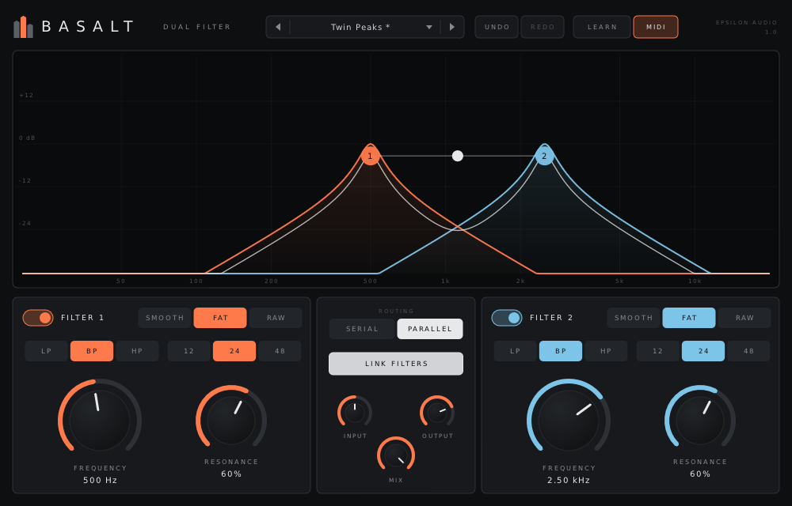
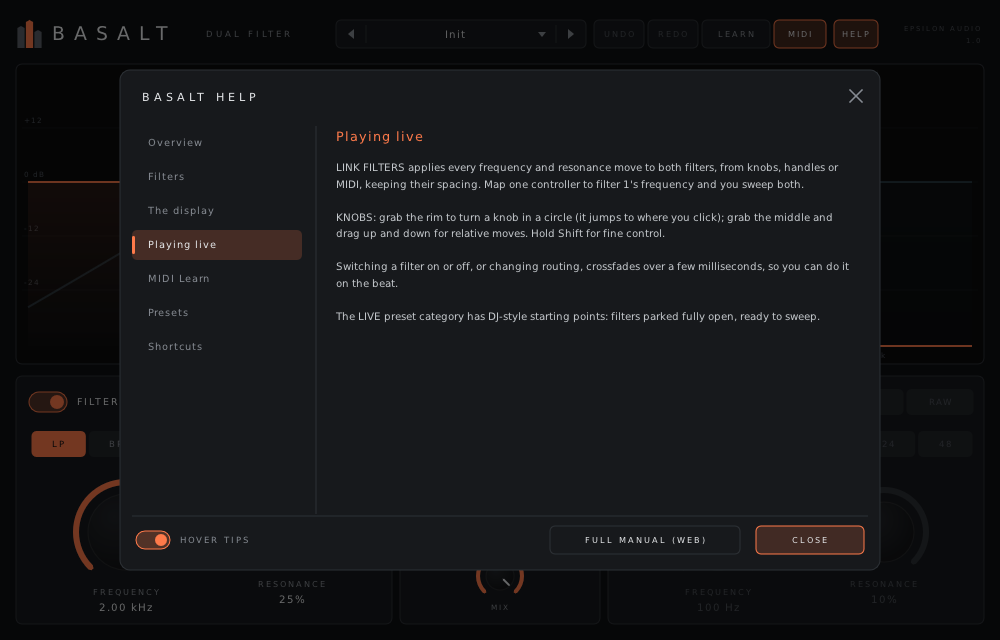

# Basalt

**A stereo dual filter for live use, for macOS, Windows and Linux (VST3 · AU · CLAP · VST2).**

Part of **[Epsilon Audio](https://github.com/natehouk/epsilon-plugins)**, a family of free, open-source plugins: Monolith, Caldera, Obsidian, Strata and Basalt.



Basalt is a clean-room design with the feature set of FabFilter Simplon, FabFilter's fifth plugin (October 2006), which was a simpler, CPU-light version of Volcano for live use. It was written from scratch, working only from FabFilter's public press release and product descriptions. No FabFilter code, binaries, presets, artwork or trademarks were used.

It is part of a family:
- [Monolith](https://github.com/natehouk/monolith), a synth
- [Caldera](https://github.com/natehouk/caldera), the full-featured dual filter. Basalt is Caldera with the modulation removed and the controls made bigger.
- [Obsidian](https://github.com/natehouk/obsidian), a polysynth
- [Strata](https://github.com/natehouk/strata), a tape delay
- **Basalt**, this plugin

## Download

Get the latest build from [**Releases**](../../releases):

| Platform | File | Contains |
|---|---|---|
| macOS 10.13+ (Apple Silicon + Intel) | `Basalt-macos-universal.zip` | VST3, AU, CLAP |
| Windows x64 | `Basalt-windows-x64.zip` | VST3, CLAP, VST2 |
| Linux x64 | `Basalt-linux-x64.zip` | VST3, CLAP, VST2 |

### Install

| Platform | Copy | To |
|---|---|---|
| macOS | `Basalt.vst3` / `Basalt.component` / `Basalt.clap` | `~/Library/Audio/Plug-Ins/VST3` / `Components` / `CLAP` |
| Windows | `Basalt.vst3` (folder) / `Basalt.clap` | `C:\Program Files\Common Files\VST3\` / `CLAP\` |
| Linux | `Basalt.vst3` / `Basalt.clap` | `~/.vst3/` / `~/.clap/` |

**macOS:** the plugins are ad-hoc signed, not notarized. After copying, run:

```
xattr -dr com.apple.quarantine ~/Library/Audio/Plug-Ins/*/Basalt*
```

## Features

**Two filters**
- **Low / band / high pass** at **12, 24 or 48 dB/oct**: nine responses per filter.
- **Three characters:**

  | Character | Sound |
  |---|---|
  | **Smooth** | Moderate overdrive and wide resonance. Never self-oscillates. |
  | **Fat** | Soft-limited resonance that self-oscillates smoothly. This is Monolith's filter. |
  | **Raw** | Hard-clipped feedback that self-oscillates with a buzz. |

- Each filter has **Frequency** and **Resonance** knobs and its own on/off switch.
- **Serial or parallel** routing.
  - **Serial**: filter 1 feeds filter 2.
  - **Parallel**: both filters read the input and are mixed together.

**Built for live use**
- **Large interactive display.** It shows both curves plus their combined response (white).
  - Drag a numbered handle: left/right sets frequency, up/down sets resonance.
  - Drag the dot between the handles to move both filters together.
  - Cmd/Ctrl-drag a handle to move the other filter in the opposite direction.
- **Link Filters.** With it on, every frequency and resonance move is applied to both filters. That includes knob turns, handle drags and MIDI-learned controllers. Frequency moves by the same ratio, so the gap between the two filters is kept.
- **Large controls.** The frequency and resonance knobs are big and always show their value.
  - Grab a knob's **rim** to turn it in a circle (it jumps to where you click).
  - Grab its **centre** to drag up and down. Hold Shift for fine control.
- **No clicks.** Parameter changes are smoothed. Switching a filter on or off, or changing the routing, crossfades over a few milliseconds.
- **Undo / redo** for every edit, including preset loads. Use the header buttons, or Cmd/Ctrl-Z and Cmd/Ctrl-Shift-Z.
- **Input gain, output gain and mix** controls.

**Help built in**
- **Hover tips.** Rest the pointer on any control, handle or header button for a moment to see what it does, its current value and any MIDI CC assigned to it.
- **HELP window.** Short pages on the filters, the display, playing live, MIDI Learn, presets and shortcuts. It has a switch for the hover tips and a link to the full manual.
- **[Full manual](docs/MANUAL.md).** It's also included in every release zip as `Basalt-Manual.html`.



**Workflow** (shared with the rest of the family)
- **MIDI Learn:**
  1. Click **LEARN**.
  2. Click a control, then move a knob or fader on your controller.
  3. Right-click a control to unassign it, or use **Clear all assignments**.

  Assignments are saved with your project. The **MIDI** switch turns MIDI control off.
- **31 factory presets** in five categories: Low Pass, High & Band, Dual, Resonant, and Live. Live has DJ-style starting points for sweeping.
- **Save your own presets** as small text files, which load the same on every OS:
  - macOS: `~/Library/Audio/Presets/Epsilon Audio/Basalt/`
  - Windows: `%APPDATA%\Epsilon Audio\Basalt\Presets\`
  - Linux: `~/.config/epsilon-audio/basalt/presets/`
- To delete a user preset, right-click it in the menu, then click it again to confirm.
- **Resizable** window, double-click to **type a value**, **Cmd/Ctrl-click** to reset a control, and the mouse wheel adjusts knobs.

### Compared with FabFilter Simplon (2006)

| Simplon | Basalt |
|---|---|
| Two multimode filters, serial or parallel | ✓ |
| LP / HP / BP at 12 / 24 / 48 dB/oct (up to 27 filter types) | ✓ |
| Three characters, smooth to raw and self-oscillating | ✓ Smooth, Fat, Raw |
| Large interactive display; adjust the filters separately or together | ✓ plus Link Filters |
| Big controls; vertical and circular knob dragging | ✓ |
| Interactive MIDI Learn | ✓ |
| Smoothed parameter changes, sample-accurate automation | ✓ |
| Undo / redo, preset browser | ✓ plus saving your own presets |
| Interactive help hints and a help file | ✓ hover tips, in-plugin help pages, full manual |
| CPU-friendly | ✓ about 1% of one core with both 48 dB filters running |
| Pro Tools (RTAS/AAX) | Not supported (needs Avid's SDK and signing) |

## Build from source

The plugin is built on [DPF](https://github.com/DISTRHO/DPF):

```
git clone --recursive https://github.com/DISTRHO/DPF.git dpf
make -C plugins/Basalt                    # Linux / macOS (macOS also builds the AU)
make -C plugins/Basalt WINDOWS=true CC=x86_64-w64-mingw32-gcc CXX=x86_64-w64-mingw32-g++
```

GitHub Actions builds all three platforms on every push. The macOS build is universal and ad-hoc signed. A `v*` tag, or a release published on GitHub, attaches the zips to that release.

## Tests

```
cd tests
g++ -O2 -std=c++11 features.cpp -o features && ./features   # slopes vs Butterworth, HP/BP, characters, routing, click-free switching, gains, link
g++ -O2 -std=c++11 fuzz.cpp -o fuzz && ./fuzz               # random parameters at 44.1–192 kHz: finite, <= 0 dBFS
g++ -O2 -std=c++11 presets.cpp -o presets && ./presets      # plays every factory preset
g++ -O3 -std=c++11 bench.cpp -o bench && ./bench            # CPU: both filters at 48 dB, parallel, frequencies moving
```

Release checks:
- Steinberg's VST3 validator passes 47/47.
- The interface is exercised with scripted input, including handle dragging with Link, circular knob drags, undo/redo, MIDI Learn and presets.

## Source layout

| File | Contents |
|---|---|
| `plugins/Basalt/BasaltEngine.hpp` | All DSP. Header-only |
| `plugins/Basalt/ParamDefs.hpp` | Parameter table, labels, value mapping, link rules |
| `plugins/Basalt/Presets.hpp` | Factory presets |
| `plugins/Basalt/UserPresets.hpp` | User preset files |
| `plugins/Basalt/BasaltPlugin.cpp` | Plugin wrapper: parameters, programs, MIDI Learn |
| `plugins/Basalt/BasaltUI.cpp` | Custom vector interface (NanoVG) |
| `plugins/Basalt/Help.hpp` | Hover tip text and in-plugin help pages |
| `docs/MANUAL.md` | User manual (`Basalt-Manual.html` is generated from it with pandoc) |

New parameters are only ever appended, so saved sessions and automation keep working across versions.

## License

[MIT](LICENSE). Built with [DPF](https://github.com/DISTRHO/DPF) and its bundled NanoVG, which are under the ISC license. `plugins/Basalt/ResizeHandle.hpp` comes from DPF's examples and keeps its ISC notice.

"FabFilter" and "FabFilter Simplon" are trademarks of FabFilter Software Instruments. Basalt is not affiliated with or endorsed by FabFilter.
